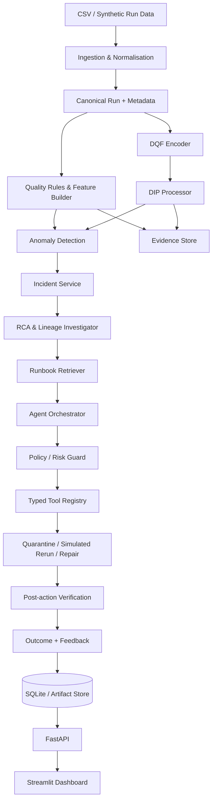

# DataGuard AI
## Architecture, Requirements and IDE Build-Governance Report

**Project ID:** HSR-AGAI-001  
**Original project title:** Agentic Data Quality Incident Detection, Root-Cause and Remediation Agent  
**DIP integration title:** Digital Image Processing-Based Visual Data-Quality Inspection  
**Document version:** 1.0  
**Prepared:** 10 November 2026  
**Status:** Architecture baseline for implementation  
**Primary implementation target:** Reproducible local prototype / modular monolith

---

## 0. Read this first: decision summary for the IDE

This document is the authoritative project contract. Build **one integrated application**, not a collection of disconnected demos.

The original HSR-AGAI-001 problem remains the product core. The DIP component is an additional perception/evidence module that analyses visual fingerprints derived from pipeline telemetry. It must not replace structured data-quality checks, anomaly detection, root-cause analysis (RCA), runbook retrieval, remediation, approvals, or outcome verification.

### Non-negotiable implementation decisions

1. **Architecture:** one Python modular monolith. Use packages/modules with explicit boundaries; do not split into microservices.
2. **Single source of truth:** structured quality rules run once in `quality.py`. The DIP module processes a visual representation of canonical telemetry; it must not reimplement data-quality rules.
3. **One orchestration path:** a single `AgentOrchestrator` coordinates state transitions and calls tools. API routes and dashboard code must not reimplement agent logic.
4. **Tool boundary:** all state-changing actions go through registered, typed tools with preconditions, risk levels, audit records and idempotency. The LLM cannot directly call arbitrary Python, SQL, shell or filesystem operations.
5. **Safe prototype:** operate on synthetic/local data. Quarantine and rerun are simulated application actions. No destructive external-system changes.
6. **DIP evidence:** generate deterministic fingerprint images from a time window of pipeline telemetry; execute and save intermediate DIP outputs; compare baseline and improved segmentation; score against synthetic ground-truth masks.
7. **Configuration:** thresholds, paths, model parameters, risk rules, image-processing parameters and feature lists belong in validated configuration. No scattered magic numbers.
8. **Logging:** configure logging once at application startup. Modules use `logging.getLogger(__name__)`. Persist agent/tool actions separately as audit events.
9. **Change control:** update the root `ACTION.md` for meaningful codebase changes only (source, tests, configuration, reproducible data/evaluation artifacts, or runtime behavior). Exclude README/presentation-only edits, formatting, and branch/history administration. Keep it concise, chronological and factual. Never silently change the architecture or requirements.
10. **Checkpoint discipline:** do not start a later checkpoint until the current checkpoint's acceptance tests pass or the blocker is explicitly recorded.

### Explicitly do not add unless approved

Kafka, Spark, Trino, Kubernetes, cloud infrastructure, Redis, Celery, MLflow, a vector database, LangChain/LangGraph, multiple agents, React/Next.js, authentication/roles, real external data connectors, or a distributed microservice architecture. These are not needed to prove this project's requirements in a bounded academic prototype. The source project bank lists several enterprise technologies as suggestions, not as mandatory components.

### Build objective

Produce a local, reproducible application that demonstrates the full closed loop:

`telemetry -> quality evidence -> anomaly/incident -> investigation/RCA -> runbook retrieval -> plan -> guarded tool action or human approval -> verification -> persisted outcome/feedback`.

The UI is a client of the backend. It is not a second implementation of the system.

---

## 1. Source basis and interpretation boundary

### 1.1 Requirements taken directly from the supplied course document

The supplied *Digital Image Processing (DIP) Course Project Guidelines* requires a substantive image/vision contribution. It specifically calls for a defined visual input/dataset, meaningful DIP operations, intermediate outputs, a baseline and an improved/alternative method, quantitative and visual comparison, reproducible implementation, and analysis of success/failure cases. It says a generic dashboard or LLM chat interface alone is not a DIP project. It also states that the 62-project bank is an industry-reference/inspiration list, not an exemption from the DIP requirement. (Source [S1], PDF pp. 1-4.)

The same document defines the common agentic flow as observe/input, perception or prediction, semantic state, memory/RAG where useful, reason/plan, tool/API action, guardrails/HITL, outcome and feedback/benchmarking. It requires the team to define state, goals, candidate actions, tool interfaces, memory/RAG where relevant, guardrails, feedback and benchmarking. (Source [S1], PDF p. 4.)

### 1.2 Requirements taken directly from HSR-AGAI-001

HSR-AGAI-001 requires the prototype to use:

- telemetry;
- pipeline metadata;
- data-quality rules;
- incident history;
- anomaly detection;
- causal/rule-assisted RCA;
- RAG over runbooks;
- data preparation, a core algorithm/model and evaluation;
- an API or usable application interface;
- persistent storage where appropriate;
- tests and reproducible execution/deployment.

The specified incident metrics include F1/PR-AUC, mean time to detect (MTTD), groundedness and latency. The agent must hold/quarantine an unreliable batch, inspect lineage and schema changes, retrieve the relevant runbook, recommend or trigger safe rerun/repair, and escalate high-risk remediation to a data engineer. It also requires explicit state, goal, reasoning/planning, at least two safe tool/API actions, memory/RAG where appropriate, guardrails/HITL, outcome logging, and a usable API/dashboard. (Source [S1], PDF pp. 8-9.)

### 1.3 Design decisions added by this report

The following are implementation recommendations, not verbatim requirements from the source:

- the Data Quality Fingerprint image encoding and its axes;
- the exact module boundaries, API routes, database entities and state machine;
- the selected local Python stack;
- the rules for when an action requires approval;
- the three-day implementation sequence;
- the proposed DIP segmentation algorithms and evaluation protocol.

These decisions operationalise the source requirements while keeping the core HSR-AGAI-001 problem unchanged.

### 1.4 Important academic approval caveat

The visual fingerprint design is a defensible proposed DIP contribution, but course acceptance is ultimately the instructor's decision. Get the visual problem and its evaluation approved. Do not claim that converting arbitrary metrics into a heatmap automatically makes a project a DIP project. The implementation must show why each image operation is useful, preserve a stable mapping from pixels to telemetry, and measure segmentation quality against known labels.

---

## 2. Project definition and high-level goals

### 2.1 Problem definition

Data pipelines can produce technically successful runs whose outputs are incomplete, malformed, duplicated, shifted or otherwise unreliable. Monitoring only whether a job succeeded is insufficient. The system must inspect run telemetry and metadata, detect suspicious data states, investigate likely causes using pipeline dependencies/schema changes/history, retrieve relevant operational guidance, and take a safe or approved action. It must then verify whether the action improved the state and record the outcome.

### 2.2 System goal

Given a pipeline run and its recent history, identify whether the output is unreliable, produce traceable evidence for the decision, identify plausible causes, select an appropriate runbook, and safely resolve or escalate the incident while preserving a full audit trail.

### 2.3 Success is not “the LLM gave an answer”

A successful incident workflow must have all of the following:

1. a reproducible input run;
2. a structured finding or model signal;
3. a persisted incident with evidence;
4. a plausible RCA supported by lineage/schema/history evidence;
5. relevant runbook sections retrieved and cited;
6. a typed action proposal with risk and preconditions;
7. an executed safe action or a recorded approval/escalation;
8. a post-action verification result;
9. a persisted outcome and metrics record.

An LLM response without these artifacts is not a completed workflow.

---

## 3. Problem-statement decomposition: goals and acceptance criteria

Each row below is independently testable. These IDs should be used in code comments only where useful, tests, issues and `ACTION.md`; do not create a class for every requirement.

| ID | Problem-statement goal | System responsibility | Minimum acceptance evidence |
|---|---|---|---|
| G-01 | Use pipeline telemetry | Ingest run-level metrics and time data | A deterministic set of normal and faulty runs can be loaded and queried |
| G-02 | Use pipeline metadata | Track pipeline, source/target, schema version, upstream/downstream links and dependencies | An incident view can show its pipeline and upstream/downstream context |
| G-03 | Use data-quality rules | Compute null, duplicate, invalid-value, row-count, schema and distribution findings | Each finding includes rule ID, observed value, expected/baseline value, severity and evidence |
| G-04 | Use incident history | Persist previous runs/incidents/actions and use relevant history during investigation | RCA can cite related historical incidents; history survives restart |
| G-05 | Detect anomalies | Combine rule baseline with an ML anomaly detector | Held-out labelled runs produce incident precision, recall, F1 and PR-AUC/AP |
| G-06 | Perform causal/rule-assisted RCA | Rank likely causes using findings, metadata, lineage, schema diffs and history | RCA returns ranked hypotheses with evidence and confidence, not unsupported prose |
| G-07 | Use RAG over runbooks | Retrieve relevant operational instructions | Each retrieved item has runbook ID, section/title, score and source text; agent answer cites IDs |
| G-08 | Hold/quarantine unreliable batch | Prevent a flagged batch from being treated as trusted in the prototype | Quarantine action changes persisted batch state, is reversible/idempotent and is audited |
| G-09 | Inspect lineage and schema changes | Surface upstream chain and compare schema versions | Investigation result names changed fields and related upstream nodes when available |
| G-10 | Recommend/trigger safe rerun or repair | Generate an action proposal and execute only allowlisted safe actions | Simulated rerun/repair is executed only after policy checks; outcome is verified |
| G-11 | Escalate high-risk remediation | Route risky/ambiguous/destructive proposals to a human | High-risk action cannot execute without an explicit approval record |
| G-12 | Closed-loop agent | Observe, reason, plan, act, verify and record feedback | One end-to-end run demonstrates the full state/action trace |
| G-13 | API or usable application interface | Expose health, runs, incidents, investigations and actions | API docs work and core paths pass integration tests |
| G-14 | Persistent storage | Preserve runs, findings, incidents, RCA, retrieval, approvals, actions and outcomes | Restarting the app does not erase the project state |
| G-15 | Reproducibility and operations | Provide deterministic data, tests, logs and repeatable setup | A fresh setup can run the documented demo and test suite |
| G-16 | DIP visual inspection | Produce and process visual fingerprints from canonical telemetry | Input/intermediate/final images, baseline/improved comparison and mask metrics are saved |
| G-17 | Evidence and benchmarking | Record performance and limitations | Evaluation report includes model, DIP, agent, tool and latency results plus failure cases |

### 3.1 Required synthetic incident scenarios

Create deterministic, labelled scenarios. Use a fixed random seed and separate train/validation/test data by pipeline run or time; do not randomly split near-duplicate rows from the same incident across train and test.

| Scenario | Injected defect | Expected evidence | Likely investigation/remediation path |
|---|---|---|---|
| S-01 Row-count drop | Sudden fall in output rows against historical baseline | Row-count delta, source/target counts, upstream run status | Inspect upstream dependency; recommend safe rerun simulation |
| S-02 Schema drift | Column added/removed/renamed or type changed | Schema diff, affected field and downstream dependency | Retrieve schema-drift runbook; quarantine; request approval for schema repair |
| S-03 Null surge | Null percentage rises in selected fields | Per-field null rate and threshold breach | Inspect source/transform history; quarantine; suggest repair or escalation |
| S-04 Duplicate spike | Duplicate key count/rate increases | Duplicate count and affected key | Retrieve duplicate-handling runbook; propose deduplication in simulation |
| S-05 Distribution shift | Numeric range/mean/variance shifts | Robust z-score/quantile drift and field-specific evidence | Inspect upstream source or transformation change |
| S-06 Execution-time spike | Runtime significantly exceeds historical baseline | Duration deviation and stage timing if available | Inspect resource/input-size context; recommend investigation, not automatic data repair |
| S-07 Combined incident | Two or more defects occur together | Multiple findings and multi-evidence RCA | Rank competing causes; avoid assuming a single cause |

At least one scenario must be clean/normal. Include a false-positive challenge and a missing/partial-telemetry challenge.

---

## 4. Scope boundaries

### 4.1 In scope

- Local synthetic data generator and CSV/JSON ingestion.
- Pipeline and schema metadata with a small dependency/lineage graph.
- Deterministic data-quality checks and feature generation.
- Rule-based baseline and Isolation Forest as the primary unsupervised anomaly model.
- DIP image generation, processing, segmentation and connected-region analysis.
- RCA based on explicit rules/evidence and historical incidents.
- Local runbook corpus and retrieval augmented generation (RAG).
- A single agent orchestrator with typed state transitions and tool registry.
- Safe local quarantine, simulated rerun/repair, approval and escalation.
- SQLite persistence, FastAPI backend, Streamlit dashboard.
- Automated tests, evaluation scripts, Docker-based reproducibility and documentation.

### 4.2 Out of scope for this prototype

- Connecting to real enterprise data platforms or private Acceldata systems.
- Executing production Spark/Kafka/Kubernetes jobs.
- Real destructive repairs or irreversible batch mutation.
- Multi-agent collaboration or autonomous self-modifying code.
- Distributed event streaming, cloud deployment and production-scale throughput guarantees.
- Model training infrastructure, MLflow registry, online feature store or vector-database operations.
- Complex authentication, multi-tenant permissions and enterprise role management.

### 4.3 Scope rule

A proposed feature is rejected or deferred unless it directly satisfies a source requirement, fixes a demonstrated defect, improves measured evaluation, or is necessary for reproducibility/safety. “It is easy for the IDE to add” is not a valid reason.

---

## 5. DIP integration: Data Quality Fingerprint Inspection

### 5.1 Purpose

The DIP module is an additional visual perception channel. It transforms a fixed window of quality telemetry into an image, processes the image using classical DIP operations, and returns **visual evidence** about anomalous regions. It does not replace the structured quality engine or become a second implementation of the same rules.

### 5.2 Visual input definition

Generate a grayscale Data Quality Fingerprint (DQF) from a fixed-length chronological window of pipeline runs.

- **Rows:** ordered run/time positions in the selected history window.
- **Columns:** a stable ordered list of `(field_id, metric_id)` channels. Example metrics: null rate, duplicate rate, invalid-value rate, robust distribution deviation, row-count contribution where field-specific, and schema/type mismatch indicator.
- **Pixel intensity:** calibrated deviation from a healthy historical baseline, mapped consistently to 8-bit grayscale. High-intensity pixels mean higher deviation according to a documented mapping.
- **Missing values:** represented by an explicit validity mask; never silently encode missing telemetry as zero-risk.
- **Axis mapping:** persist the ordered run IDs and channel IDs alongside each image so a segmented region can be mapped back to a run and metric/field.
- **Versioning:** persist encoder version, metric list, baseline version, image dimensions and DIP configuration with every artifact.

The history window, channel order and normalisation rules must be stable between training, validation and inference. Do not normalise each image independently in a way that makes the same absolute deviation appear different from run to run.

### 5.3 DIP pipeline

**Baseline method (DIP-B0):**

1. Convert the calibrated fingerprint to a single-channel image.
2. Apply a configured global threshold (Otsu or fixed baseline threshold; record which one).
3. Extract connected components and map them back to telemetry channels/runs.

**Improved method (DIP-P1):**

1. Apply a small median filter only if synthetic noise tests show salt-and-pepper artefacts; record kernel size.
2. Apply adaptive thresholding to handle local variation in the fingerprint.
3. Apply morphological opening to remove isolated foreground noise and/or closing to fill small gaps. Use a documented structuring element and kernel size.
4. Run connected-component analysis.
5. Extract region area, bounding box, centroid, temporal span, channel span, peak intensity and density.
6. Map region measurements to source run IDs and telemetry channels.

Do not enable every operation automatically. The configuration must make each step selectable, and the evaluation must justify the selected sequence. Avoid CLAHE/histogram equalisation if it distorts calibrated risk intensity; use it only as an experiment with measured benefit.

### 5.4 DIP output contract

`DIPArtifact` must contain:

- `artifact_id`, `pipeline_id`, `window_run_ids`;
- encoder/config versions and timestamp;
- image paths or stable artifact references for raw, baseline mask, improved mask and overlay;
- ordered channel map and run map;
- region records with coordinates and mapped fields/metrics/run IDs;
- segmentation method and parameters;
- ground-truth mask reference when evaluating synthetic data;
- processing duration and failure/warning details.

A UI screenshot is not a substitute for saving the actual intermediate arrays/images.

### 5.5 How DIP connects to the original detector/RCA

The integration is intentionally one-way and narrow:

`canonical telemetry/features -> fingerprint encoder -> DIP processor -> DIPArtifact + region features -> detector/RCA evidence`.

- The quality engine remains the source of structured quality findings.
- The DIP module never decides whether a SQL/data-quality rule passes or fails.
- The anomaly detector may receive a small number of DIP-derived region features (for example, maximum region persistence, region density and affected-channel count) only after the ablation test is implemented.
- RCA may display/consider DIP region evidence with a link to the mapped telemetry. It must not treat a segmented patch as causal proof.
- If adding DIP features does not improve held-out incident performance, retain the DIP module as an investigation/evidence aid and report the negative ablation result honestly. Do not force a performance claim.

### 5.6 DIP evaluation

Use synthetic ground-truth masks derived from the injected anomalies.

- Pixel/region segmentation: precision, recall, F1 and IoU or Dice.
- Baseline vs improved: same held-out fingerprint images and labels.
- Runtime: median image-processing time per fingerprint.
- Visual evidence: raw fingerprint, baseline mask, improved mask, overlay and at least three success/failure examples.
- Ablation: structured features only vs structured + DIP region features for incident detection.

The DQF approach is a designed visual encoding of telemetry, not a natural image dataset. State that limitation in the report and explain why the chosen topology/operations are meaningful for persistent, multi-metric patterns.

---

## 6. Target architecture

### 6.1 Architecture style

Use a **modular monolith** with clear ports/adapters and dependency direction. The goal is to keep modules independent enough to test, not to create separate deployable services.



### 6.2 Dependency direction

`domain -> application/use cases -> infrastructure adapters -> presentation`.

- Domain types must not import FastAPI, Streamlit, SQLAlchemy, OpenCV, sentence-transformers or provider SDKs.
- Application services depend on interfaces/protocols, not concrete UI/database clients.
- Infrastructure implements those interfaces.
- FastAPI routes call application services; they do not implement algorithms.
- Streamlit calls the FastAPI API; it does not import service internals or directly query SQLite.
- No circular imports. If two modules need each other, move their shared type to `domain/` or define a narrow interface.

### 6.3 Single-responsibility ownership

| Concern | Sole owning module | Must not be duplicated in |
|---|---|---|
| Run parsing/normalisation | `ingestion.py` | API routes, dashboard, detector |
| Rule evaluation | `quality.py` | DIP, RCA, agent planner |
| Canonical feature construction | `features.py` | quality model, dashboard, RCA |
| Fingerprint image generation | `dip/encoder.py` | Streamlit, detector, DIP processor |
| DIP operations/segmentation | `dip/processor.py` | dashboard, RCA, fingerprint encoder |
| DIP pipeline composition | `visual_inspection.py` | dashboard, detector (delegates to the two DIP owners) |
| Incident decision | `detection.py` + `incidents.py` | dashboard, route handlers, LLM prompt |
| RCA hypothesis ranking | `rca.py` | agent planner, dashboard |
| Runbook retrieval | `rag.py` | agent, route handlers, dashboard |
| State transitions/planning | `agent.py` | API routes and UI callbacks |
| Action execution | `tools.py` | orchestrator inline code, API routes |
| Approval/risk decision | `policy.py` | tools, dashboard |
| Persistence queries | `persistence.py` | domain models, dashboard |
| Application logging setup | `logging_config.py` | individual feature modules |
| Metrics/evaluation | `evaluation.py` | dashboard calculations and model modules |

### 6.4 Target repository layout (compact baseline)

Use this compact layout as the starting point. Split a file into a subpackage only when it becomes difficult to navigate or it has a real independent interface. Do not create empty modules in advance.

```text
dataguard-ai/
├── AGENTS.md
├── ACTION.md
├── README.md
├── pyproject.toml
├── .env.example
├── .gitignore
├── Dockerfile
├── compose.yaml
├── configs/
│   ├── default.yaml
│   └── scenarios.yaml
├── data/
│   └── runbooks/
├── artifacts/
│   ├── fingerprints/
│   └── evaluation/
├── docs/
│   ├── architecture.md
│   ├── data_dictionary.md
│   ├── evaluation_protocol.md
│   └── decisions.md
├── src/datagard/
│   ├── main.py                 # composition root / startup
│   ├── config.py               # validated settings
│   ├── logging_config.py       # one logging setup
│   ├── contracts.py            # domain types, enums, request-independent DTOs
│   ├── ingestion.py            # generator, loaders, normalisation
│   ├── metadata.py             # schema registry, schema diff, lineage
│   ├── quality.py              # quality rules and findings (single owner)
│   ├── features.py             # canonical feature builder (single owner)
│   ├── dip/
│   │   ├── encoder.py          # sole DQF encoder
│   │   └── processor.py        # sole image-processing/segmentation owner
│   ├── visual_inspection.py    # thin DIP pipeline composition facade
│   ├── detection.py            # rule baseline + Isolation Forest
│   ├── incidents.py            # incident lifecycle and deduplication
│   ├── rca.py                  # evidence-based cause ranking
│   ├── rag.py                  # runbook chunking, embeddings, retrieval
│   ├── agent.py                # state machine, planner, orchestrator
│   ├── policy.py               # risk and approval rules
│   ├── tools.py                # typed tool registry and safe actions
│   ├── verification.py         # post-action checks
│   ├── persistence.py          # SQLite/SQLAlchemy repositories
│   ├── api.py                  # FastAPI routers and schemas
│   └── evaluation.py           # detector, DIP and agent metrics
├── ui/
│   └── app.py                  # Streamlit API client only
└── tests/
    ├── unit/
    ├── integration/
    ├── scenarios/
    └── conftest.py
```

This is an initial ownership map, not a command to create every file at CP-0. For example, `verification.py` may begin as a small function inside `agent.py` and be extracted only when it earns a separate boundary. Conversely, do not collapse all project logic into `main.py` or one generic `services.py`. Keep the ownership rules in §6.3 even when files are grouped.

---

## 7. Core component requirements and contracts

### 7.1 Ingestion and normalisation

**Goal:** turn synthetic CSV/JSON inputs into one canonical `PipelineRun` representation.

Required fields: `run_id`, `pipeline_id`, `started_at`, `completed_at`, `status`, `input_rows`, `output_rows`, `duration_ms`, `schema_version`, source/target identifiers, and field-level metrics where available.

Rules:
- Validate required fields and types at the boundary.
- Preserve raw source records for reproducibility; normalise into canonical records once.
- Reject or quarantine malformed telemetry with a descriptive ingestion error; do not silently coerce unknown values.
- Make the synthetic generator deterministic through a configured seed.
- Generate ground-truth labels separately from model input features to avoid label leakage.

### 7.2 Metadata and lineage

Represent pipeline dependencies as a directed graph. A minimal adjacency list/edge table is sufficient. Schema registry stores versioned ordered field definitions: field name, type, nullable, key flag and schema version.

The system must compute a schema diff between a run's observed schema and the expected/previous schema. RCA consumes the diff; it must not implement its own schema comparison.

### 7.3 Data-quality engine

Required initial checks:

- null/missing rate per field;
- duplicate count/rate for configured keys;
- input/output row-count delta;
- schema added/removed/renamed/type-changed fields;
- invalid type/range/value checks;
- numeric distribution deviation against a training/history baseline.

Each check returns a standard `QualityFinding`: `finding_id`, `run_id`, `rule_id`, `field_id` (nullable), `severity`, `observed`, `expected_or_baseline`, `message`, `evidence`, `created_at`.

Use configuration for thresholds. Rule execution must be deterministic and unit-tested. Rule findings are evidence; an individual rule breach does not automatically mean the whole run is an incident unless the rule severity/policy says so.

### 7.4 Feature builder and anomaly detection

There must be one canonical feature builder. It transforms run metrics and findings into a stable, named feature vector used by the ML model and evaluation. Persist the feature names/order and model version.

Minimum detector design:

- **Baseline:** deterministic threshold/rule-based baseline.
- **ML model:** scikit-learn Isolation Forest with fixed `random_state`, documented contamination/threshold selection and train-only fitting.
- **Output:** `anomaly_score`, `is_anomaly`, `model_version`, `threshold`, `top_feature_evidence` where available.
- **Calibration:** do not present Isolation Forest's score as a calibrated probability. Call it a score.
- **Evaluation:** report precision, recall, F1 and average precision / PR-AUC-like ranking metric on labelled held-out runs. In the report, state clearly whether the number is Average Precision or trapezoidal PR-AUC; do not label both as the same metric.

For anomaly detection, tune the decision threshold on validation data and freeze it before test evaluation. Report a confusion matrix and compare against the rule baseline.

### 7.5 Incident service

Create/update an incident when configured detection policy is met. Avoid one new incident per metric per run. Deduplicate by a stable key such as `(pipeline_id, affected_run_id, incident_family)` and support multiple findings under one incident.

Incident must store status, severity, detection time, affected run/batch, evidence references, detector version, and lifecycle timestamps. Incident status changes must go through the incident service/state machine.

### 7.6 RCA and lineage investigation

RCA is rule-assisted and evidence-grounded. It must not rely on free-form LLM reasoning as the source of truth.

Inputs: quality findings, run telemetry, schema diff, lineage graph, recent run history, prior incidents and action outcomes, optional DIP region features.

Output: ranked `RCAHypothesis` records with `cause_code`, `summary`, `confidence_or_rank`, supporting evidence IDs, contradicting/missing evidence, affected upstream/downstream nodes and recommended next investigation. Distinguish “observed fact” from “hypothesis”.

Initial rule families:

- row-count drop + upstream failure/volume reduction -> upstream source or dependency issue;
- type/schema mismatch + recent schema change -> schema drift;
- null surge concentrated in selected source fields -> source data or mapping issue;
- duplicate spike + repeated keys -> deduplication/key-generation issue;
- numeric distribution shift without schema change -> source population or transformation change;
- runtime spike with stable row counts -> execution/resource/partition issue.

If evidence is insufficient or competing causes remain close, return `INCONCLUSIVE` and escalate/ask for review. Do not fabricate a root cause.

### 7.7 Runbook RAG

Store curated Markdown runbooks for at least: schema drift, row-count drop, null surge, duplicate spike, distribution shift, safe rerun and escalation.

Required retrieval path:

1. Chunk runbooks with stable document and section IDs.
2. Embed chunks using a configured embedding model (recommended: a small Sentence Transformers model such as `all-MiniLM-L6-v2`).
3. Compute cosine similarity for the small local corpus; use in-memory or persisted local vectors. A vector database/FAISS is not required for this small corpus.
4. Retrieve top-k chunks with source IDs, scores and text.
5. Pass retrieved text to the planner/summariser, together with the evidence bundle.
6. Return runbook source IDs with the recommendation.

Provide a deterministic lexical fallback (e.g. TF-IDF) if embedding download or inference is unavailable. Do not make the app unstartable because a model provider is down.

The RAG module owns chunking, embedding and retrieval. Neither the agent nor the API may implement a second retrieval path.

### 7.8 Agent orchestrator and semantic state

Use one explicit state object. Suggested state fields:

`incident_id`, `run_id`, `goal`, `current_status`, `findings`, `anomaly_result`, `dip_artifact_id`, `lineage_context`, `rca_hypotheses`, `retrieved_runbook_refs`, `action_proposals`, `approval_status`, `executed_actions`, `verification_result`, `feedback`, `correlation_id`.

Suggested state machine:

`NEW -> INVESTIGATING -> PROPOSED -> (AWAITING_APPROVAL | READY_TO_EXECUTE) -> EXECUTING -> VERIFYING -> (RESOLVED | ESCALATED | FAILED)`.

All transitions are validated. Invalid transitions fail loudly and are logged. Store each state transition in the audit/event history.

Planner output must be a typed plan, not arbitrary executable code. Example fields: `goal`, `steps`, `selected_tool`, `arguments`, `risk_level`, `preconditions`, `expected_outcome`, `evidence_refs`, `runbook_refs`, `requires_approval`.

LLM usage is optional and replaceable. A deterministic rules-based planner must be able to run the complete demo without an API key. An LLM may summarise evidence or choose among already-allowed plan templates; it may not bypass policy, invent tool arguments, or execute actions.

### 7.9 Tools and action policy

Minimum tools:

| Tool | Effect | Risk / guardrail |
|---|---|---|
| `inspect_pipeline` | Read run, metadata, schema, lineage and history | Read-only; always allowed |
| `quarantine_batch` | Mark unreliable batch as quarantined in local state | Reversible; precondition: incident is open and run ID exists; idempotent |
| `retrieve_runbook` | Retrieve runbook chunks | Read-only; cite source IDs |
| `simulate_rerun` | Create a simulated rerun record; do not invoke a real scheduler | Low/medium; only on known pipeline/run; audit all parameters |
| `simulate_repair` | Produce a repaired output in a separate sandbox artifact, preserving original | Medium/high; approval required for destructive/ambiguous transformations |
| `escalate_incident` | Create a human-review request with reason and evidence | Safe; always record target role/queue as simulated if no real integration |

At least two state-changing tool actions must work end-to-end; recommended demo actions are quarantine and simulated rerun. `inspect_pipeline` and `retrieve_runbook` are required investigation tools.

Every tool must declare: name, input schema, output schema, risk category, preconditions, idempotency behavior, allowed side effects and failure modes. A registry is the only route from planner to tool execution.

Never let a tool accept arbitrary filesystem paths, SQL strings, shell commands or arbitrary Python. No tool can modify the original source dataset. Repairs write to a new artifact and are verified before being considered successful.

### 7.10 Verification and feedback

After a simulated action, re-run the relevant quality checks on the resulting artifact. Record whether:

- the original defect was reduced/resolved;
- new defects were introduced;
- the batch remains quarantined;
- the action succeeded, partially succeeded or failed;
- a human override/approval occurred.

Do not mark an incident resolved solely because a tool returned HTTP 200 or a function returned without exception. Resolution requires successful post-action verification or an explicit human closure.

---

## 8. Data model and API contract

### 8.1 Minimum persisted entities

| Entity | Essential fields / purpose |
|---|---|
| `Pipeline` | id, name, source, target, owner/metadata |
| `PipelineDependency` | upstream_id, downstream_id, dependency type |
| `SchemaVersion` / `SchemaField` | versioned field metadata and schema diffs |
| `PipelineRun` | canonical run telemetry, timestamps, status, batch state |
| `QualityFinding` | rule result and evidence |
| `FeatureSnapshot` | feature names/order/values and feature version |
| `DIPArtifact` | image references, mapping, method/config and region results |
| `AnomalyPrediction` | score/label/model version/threshold |
| `Incident` | severity, status, affected run, detection and lifecycle data |
| `RCAHypothesis` | cause code, rank/confidence, evidence references |
| `RunbookChunk` | runbook/section IDs and retrieval metadata |
| `ActionProposal` | typed plan, risk, preconditions and approval requirement |
| `Approval` | approver, decision, reason and timestamps (simulated role is acceptable) |
| `ActionExecution` | tool, parameters hash, result, status, idempotency key, duration |
| `Outcome` | verification results, resolution/escalation and feedback |

Store generated images as files under `artifacts/`; persist stable relative paths and metadata in SQLite. Do not put large image byte arrays in normal incident rows.

### 8.2 API routes (minimum)

| Method + route | Purpose |
|---|---|
| `GET /health` | Liveness/readiness and configuration sanity (no secrets) |
| `POST /api/v1/demo/generate` | Generate a configured synthetic dataset/scenario set |
| `GET /api/v1/pipelines` | List pipelines and run health |
| `GET /api/v1/runs/{run_id}` | Run telemetry, findings and evidence |
| `POST /api/v1/runs/{run_id}/analyze` | Execute quality, DIP and anomaly analysis for a run/window |
| `GET /api/v1/incidents` | Filter/list incidents |
| `GET /api/v1/incidents/{incident_id}` | Incident details, RCA, evidence and history |
| `POST /api/v1/incidents/{incident_id}/investigate` | Run RCA and retrieve runbooks |
| `POST /api/v1/incidents/{incident_id}/plan` | Generate a typed action proposal |
| `POST /api/v1/actions/{action_id}/approve` | Record approval/rejection |
| `POST /api/v1/actions/{action_id}/execute` | Execute only after policy/precondition checks |
| `GET /api/v1/incidents/{incident_id}/timeline` | Full event/action/approval trace |
| `GET /api/v1/evaluation/summary` | Return computed evaluation results |

Do not implement every route as an independent orchestration path. Routes should validate requests, call one application use case and serialize its typed result.

---

## 9. Dashboard requirements

Use Streamlit as a thin client of FastAPI. Keep the dashboard readable and task-oriented.

Required screens/tabs:

1. **Overview:** run counts, pipeline status, open incidents, recent detections and key metrics.
2. **Pipeline/run detail:** telemetry, rule findings, schema version, lineage and recent history.
3. **Visual inspection:** raw fingerprint, baseline mask, improved mask, overlay, axis mapping and region details.
4. **Incident investigation:** evidence bundle, anomaly score, RCA hypotheses, supporting/contradicting evidence and runbook citations.
5. **Action centre:** typed proposal, risk, preconditions, approval/rejection and execution outcome.
6. **Evaluation:** detector metrics, DIP segmentation metrics, ablation, agent/tool metrics and latency.

Dashboard constraints:

- no data-quality rules, ML inference, RCA or agent planning in Streamlit code;
- no direct SQLite access from the UI;
- no duplicate business-logic calculations for metrics;
- controls call the backend and display returned state;
- show “simulated” next to local quarantine/rerun/repair actions;
- show evidence IDs and source references rather than unsupported AI prose.

---

## 10. Configuration, logging, constants and project memory

### 10.1 Configuration policy

Use `configs/default.yaml` for non-secret experiment/application configuration and `pydantic-settings` for environment-specific values and secrets. Load configuration once at startup and inject it into services.

Configuration categories:

- application: environment, API host/port, log level;
- paths: raw data, processed data, runbooks, artifacts, SQLite database;
- generator: seed, number of pipelines/runs/fields, scenario frequencies;
- quality: rule thresholds and severity mapping;
- features: ordered feature names and history window;
- detection: model parameters, random seed and validation threshold;
- DIP: channel order, image dimensions, pixel mapping, baseline threshold, filter/kernel/threshold/morphology settings;
- RAG: embedding model, top-k, similarity threshold and lexical fallback;
- agent: state transition policy, maximum plan steps and tool allowlist;
- risk: actions allowed without approval and approval triggers;
- evaluation: split strategy, metric names and output paths.

No magic constants in code for tunable values. Constants that are structural (enum names, canonical state labels, schema keys) live in a single constants/enums module. Do not create multiple `constants.py` files that disagree.

Secrets belong only in environment variables or local untracked `.env`; `.env.example` contains placeholder names, not keys. Never log secrets.

### 10.2 Logging policy

- Configure handlers/formatters once in `logging_config.py` from `main.py`.
- Each module uses `logger = logging.getLogger(__name__)`; do not call `basicConfig()` inside feature modules.
- Use standard levels: DEBUG for diagnostic detail, INFO for lifecycle events, WARNING for recoverable issues/policy blocks, ERROR for failed operations.
- Emit consistent context: `correlation_id`, `pipeline_id`, `run_id`, `incident_id`, `action_id`, `module`, `duration_ms` where applicable.
- Log tool start, validated parameters summary (redacted), success/failure and duration.
- Do not log full records, private data, secrets, access tokens or unbounded prompts.
- Avoid duplicate log handlers/propagation. Application events go to stdout and optionally a rotating local file.
- Agent audit trail is a database entity/event stream; ordinary text logs are not a substitute for it.

### 10.3 `ACTION.md` is mandatory codebase project memory

The root `ACTION.md` has two parts:

**A. Current project state (rewrite this summary as state changes):** current checkpoint, implemented codebase capabilities, latest passing tests, known codebase blockers, and next codebase task.

**B. Codebase change ledger:** record meaningful changes that affect source code, tests, configuration, reproducible data/evaluation artifacts, or runtime behavior. Do not log README-only or presentation-only edits, formatting, or branch/history administration. Keep entries chronological; remove out-of-scope historic entries only when the project owner explicitly directs it. Applicable entries should include:

- date and iteration/checkpoint ID;
- requirement IDs touched;
- concise change summary and reason;
- files created/modified/deleted;
- tests/commands run and exact result;
- migrations/data/config changes, if any;
- known regressions/risks and unresolved questions;
- next smallest codebase task.

The IDE must refresh the `ACTION.md` current-state summary after meaningful codebase changes, including a failed attempt that changed code. Do not claim a test passed unless it was run. A documentation-only or presentation-only task does not require a ledger entry.

### 10.4 Other documentation

- `README.md`: install, run, test, demo and reset instructions.
- `docs/architecture.md`: current diagrams and module boundaries.
- `docs/decisions.md`: short ADRs for changes to the architecture/stack/data contracts.
- `docs/data_dictionary.md`: canonical fields, units and labels.
- `docs/evaluation_protocol.md`: frozen splits, metrics and threshold selection.

When architecture changes, update the relevant diagram/decision record and `ACTION.md` in the same iteration.

---

## 11. Recommended technology stack

| Layer | Selected technology | Why this is sufficient | Avoid for this scope |
|---|---|---|---|
| Language/runtime | Python 3.11 or 3.12 | Mature ecosystem and compatibility across selected ML/DIP/API tools | Mixing Python and Java/Scala |
| Data processing | pandas, NumPy | Synthetic tabular telemetry and feature calculations | Spark for a local dataset |
| DIP | OpenCV-Python (`cv2`) | Thresholding, filtering, morphology and connected components | Neural vision model unless experiments justify it |
| ML detection | scikit-learn IsolationForest + deterministic rules | Gives a core anomaly model and interpretable baseline without training infrastructure | Deep-learning framework for a small feature table |
| Backend | FastAPI + Pydantic | Typed API contracts and modular routers | Multiple backends or a custom server |
| Configuration | Pydantic Settings + YAML config | Validated environment values and central experiment parameters | Reading environment variables across every module |
| Persistence | SQLite + SQLAlchemy 2.x | Local persistent relational data with one repository abstraction | PostgreSQL cluster for a single-user prototype |
| RAG | sentence-transformers + NumPy cosine similarity; TF-IDF fallback | Small local runbook corpus; no vector server required | LangChain, vector DB or elaborate agent framework by default |
| Agent | Explicit Python state machine + typed tool registry | Transparent, auditable and testable action control | Unbounded autonomous multi-agent framework |
| UI | Streamlit | Fast local dashboard; UI consumes API | React/Next.js frontend |
| Tests | pytest | Unit, integration and scenario tests with reusable fixtures | Manual-only testing |
| Packaging/deployment | pyproject.toml + locked dependencies + Docker/Compose | Reproducible local execution | Kubernetes/cloud pipeline |
| Logging | Python standard `logging` | Hierarchical module loggers and centrally configured handlers | Multiple competing logger frameworks |
| Version control | Git | Iteration checkpoints and reproducibility | Untracked local-only changes |

### 11.1 Dependency policy

Start with this stack only. Add a package only when a requirement cannot be met cleanly with the chosen stack. Before adding a dependency, the IDE must document: requirement ID, why current packages cannot satisfy it, maintenance/runtime cost, alternative considered, and exact files affected. Update `pyproject.toml`/lockfile and `ACTION.md` together.

### 11.2 LLM policy

The prototype must work without an LLM API key. Implement a small interface such as `Planner`/`Summarizer` with a deterministic implementation as default. A provider adapter may be added behind that interface. The LLM is never the policy engine, source-of-truth detector, RCA database, or action executor.

---

## 12. Non-functional requirements

| ID | Requirement | Acceptance condition |
|---|---|---|
| NFR-01 | Modularity | Domain/application layers do not import UI or infrastructure implementations |
| NFR-02 | No duplicated logic | Each concern has one owning module as defined in §6.3 |
| NFR-03 | Determinism | Synthetic data and model training can be reproduced from configured seeds/splits |
| NFR-04 | Traceability | Every incident/action/decision can be traced to run/evidence/config/model versions |
| NFR-05 | Safety | No destructive external actions; approval enforced server-side, not only in UI |
| NFR-06 | Persistence | Core state survives process restart |
| NFR-07 | Observability | Logs include correlation identifiers and meaningful failure context |
| NFR-08 | Testability | Each module can be tested without starting the full UI |
| NFR-09 | Reproducibility | Documented setup, seed, package lock and demo scenario produce expected outputs |
| NFR-10 | Graceful degradation | Missing embedding model/API key does not prevent the rule-based pipeline and core agent demo from running |
| NFR-11 | Performance | Record stage and end-to-end latency; do not assert an arbitrary production SLA |
| NFR-12 | Maintainability | Type hints, docstrings for public interfaces, small functions and explicit error types |

---

## 13. Evaluation and reporting protocol

Keep four evaluation tracks separate. A single “accuracy” number is insufficient.

### 13.1 Incident detection

- Precision, recall and F1 at the frozen threshold.
- Average Precision (AP) and/or trapezoidal area under the Precision-Recall curve; name the exact calculation.
- Confusion matrix and per-scenario breakdown.
- Compare rule-only baseline, Isolation Forest, and (if ablation supports it) structured + DIP-region features.
- Prevent leakage: split by run chronology or incident group; fit normalisers/models on training only.

### 13.2 Mean time to detect

Define incident start time from the injected/known ground-truth timestamp and detection time from the persisted incident creation timestamp. For detected incidents:

`MTTD = mean(detection_timestamp - incident_start_timestamp)`.

Report units and whether missed incidents are excluded; always report miss rate alongside MTTD so a system cannot appear fast by detecting only easy incidents.

### 13.3 DIP

- Pixel-level segmentation precision/recall/F1 and IoU or Dice against known masks.
- Baseline global threshold vs improved adaptive/morphological method.
- Intermediate images and examples for success, false positives, false negatives and missing telemetry.
- Processing time per fingerprint.
- Ablation showing whether DIP-derived region features change incident detection performance.

### 13.4 Agent and operational metrics

- Task completion rate across scripted scenarios.
- Tool success/error rate.
- Correct policy decision rate (blocked high-risk action, approved allowed action, approval required).
- Human approval/rejection/escalation rate.
- Runbook groundedness: fraction of recommendations with relevant, valid runbook source IDs and supporting evidence refs. Use a small manually reviewed test set; do not let the model self-grade.
- End-to-end latency and per-stage latency.
- Verification success rate and false resolution rate.

### 13.5 Required failure analysis

At minimum discuss: false positives from benign seasonality; missed low-amplitude anomalies; schema changes without historical context; misleading heatmap adjacency; missing telemetry; incorrect RCA ranking; irrelevant runbook retrieval; tool failure; approval bypass attempt; action succeeded but verification failed.

Report measured results only. If a metric has not been computed, label it “not measured”, not “excellent” or “100%”.

---

## 14. Test strategy and definition of done

### 14.1 Unit tests

- normaliser rejects malformed input and preserves valid values;
- each quality rule passes/fails representative boundary cases;
- feature builder has stable order and handles missing fields;
- DQF encoder maps known metric values to expected pixels and has stable axis maps;
- DIP baseline/improved methods return expected shape/type and map regions correctly;
- RCA rules rank expected synthetic causes and return inconclusive when evidence is weak;
- RAG returns correct runbook IDs for known queries and fallback behavior works;
- state machine rejects invalid transitions;
- tool preconditions/idempotency/risk policy are enforced;
- repository operations persist and retrieve entities.

### 14.2 Integration tests

- ingest a labelled run -> create findings -> create DIP artifact -> detector -> incident;
- incident -> lineage/schema inspection -> RCA -> runbook retrieval;
- plan -> quarantine -> verify state and audit record;
- plan -> simulate rerun -> verify new run and incident state;
- high-risk repair -> blocked without approval -> approved -> simulated repair -> post-check;
- app restart -> incident/action timeline remains available;
- API response schemas match the published contract.

### 14.3 Agent scenario tests

Use deterministic scripted scenarios; do not depend on an LLM response. Assert not only final text but state transitions, evidence references, tool calls, risk decisions and verification outcomes.

### 14.4 Definition of done for each task

A task is complete only when:

1. acceptance criteria are met;
2. targeted tests pass;
3. relevant integration tests pass or are explicitly blocked with cause;
4. no duplicated implementation was introduced;
5. configuration/logging/docs are updated where affected;
6. `ACTION.md` is updated;
7. the IDE reports exact files and test commands/results.

---

## 15. Checkpoints and implementation sequence

The checkpoint gates are the project's control system. Each gate creates a stable working state that can be demoed independently. Do not implement all modules in parallel.

| Checkpoint | Build | Required artifacts | Exit gate |
|---|---|---|---|
| CP-0 Architecture freeze | Read this report; inspect repository; create minimal skeleton/config/logging | `AGENTS.md`, `ACTION.md`, `pyproject.toml`, config, folder map, decision record | No code duplication; import direction agreed; setup works |
| CP-1 Data foundation | Synthetic generator, ingestion, metadata, lineage, canonical domain types | deterministic normal/faulty runs, data dictionary, unit tests | same seed gives same dataset; all scenario labels present |
| CP-2 Quality engine | Rules, findings, canonical features, rule baseline | tests and quality summary | each required defect scenario creates expected findings |
| CP-3 DIP pipeline | DQF encoder, baseline, improved DIP, masks, visual artifacts | raw/mask/overlay examples, channel map, segmentation metrics | known masks can be recovered and metrics computed; DIP artifacts persist |
| CP-4 Anomaly detection | Isolation Forest, threshold selection, evaluation | model artifact/version, frozen split, metric report | baseline vs ML comparison computed with no test leakage |
| CP-5 Incident + RCA + RAG | incident service, schema diff/lineage investigation, local runbooks/retriever | ranked RCA with evidence, retrieval refs | each test scenario returns expected cause family or defensible inconclusive |
| CP-6 Agent closed loop | state machine, planner, policy, registry, tools, approval, verification | traceable quarantine/rerun/repair simulation | low-risk flow completes; high-risk flow cannot bypass approval |
| CP-7 Backend + persistence | repositories, SQLite, FastAPI routes/schemas | running API, persisted records, API tests | restart preserves state; routes use application services only |
| CP-8 Dashboard | Streamlit client and pages | complete investigation/action/evaluation UI | UI reads API; no business logic duplication |
| CP-9 Release readiness | integration/scenario tests, Docker, docs, demo | reproducible repo, test report, demo script/video | clean setup runs all demo scenarios; known limitations recorded |

### 15.1 Three-day accelerated order

This is a scheduling recommendation for the previously discussed three-day window; it does not convert the semester-scale source statement into a production-scale commitment.

**Day 1:** CP-0, CP-1, CP-2, then begin CP-3. End with deterministic data and a passing quality engine.  
**Day 2:** finish CP-3, CP-4, CP-5, CP-6. End with a working CLI/script closed-loop scenario before UI work.  
**Day 3:** CP-7, CP-8, CP-9. Keep the dashboard thin; spend the final block on tests, metrics, Docker, README and demo.

If behind schedule, simplify presentation and optional features, not core safety, evidence, persistence, testability or the DIP evaluation. A complete CLI/API workflow is preferable to a beautiful dashboard with broken orchestration.

---

## 16. Anti-overengineering and IDE operating rules

The IDE must follow these rules on every iteration:

1. Read `AGENTS.md`, this report and `ACTION.md` before editing.
2. Inspect existing files and tests before creating new ones. Search for existing implementations before adding functionality.
3. State which requirement IDs the proposed change satisfies and the smallest files/modules it should affect.
4. Reuse a service/interface rather than copy-pasting logic. Never implement a second detector, second quality-rule engine, second RCA engine, second retriever, or second state machine.
5. Do not add abstraction layers without a second real use case. One implementation plus a small protocol is enough; avoid factory/manager/registry chains beyond the explicit tool registry.
6. Keep the application a modular monolith. Do not create microservices or separate databases for DIP, RAG, agent, UI or evaluation.
7. Do not generate placeholder classes, empty modules, fake metrics, synthetic “success” responses or hard-coded dashboard numbers.
8. Do not silently alter public schemas, stored data meaning, threshold defaults, state transitions or tool permissions. Add/update tests and a decision note.
9. Do not let API routes, Streamlit callbacks or the LLM own business logic.
10. Do not use the LLM to decide its own permissions or bypass server-side policy.
11. Do not put tunable values in code. Add them to the single config and document their meaning/units.
12. Do not log secrets or full sensitive rows. Log identifiers and concise evidence summaries.
13. Prefer small, readable functions with type hints and clear names. Avoid one giant service class or one giant `main.py`.
14. Do not refactor unrelated code during a feature task. Separate necessary refactor from feature work and record why.
15. After each meaningful codebase change batch, run focused tests, update `ACTION.md`, and report files changed, tests run, and known gaps.
16. If a requirement conflicts with this architecture, stop and record the conflict in `ACTION.md` plus `docs/decisions.md`; do not invent a resolution silently.
17. If blocked, report the smallest missing input or failing command. Do not paper over the issue with a mock that looks real.

### 16.1 Required IDE response format after an iteration

```text
Iteration: CP-X / task name
Requirement IDs: G-xx, NFR-xx
Plan completed: ...
Files changed: ...
Existing logic reused: ...
New logic added (and why it was not duplicative): ...
Tests/commands run: ...
Results: PASS / FAIL / NOT RUN (with reason)
Config/docs/ACTION.md updated: yes/no
Known risks/blockers: ...
Next smallest task: ...
```

---

## 17. First implementation task for the IDE

Do not start coding the whole system in one shot. The first task is **CP-0 only**:

1. inspect the existing repository and report its current structure;
2. read this report, `AGENTS.md` and `ACTION.md`;
3. create only the agreed project skeleton, package metadata, validated settings/config loader, central logger and a minimal health endpoint if the app skeleton is needed;
4. add one smoke test for configuration and health;
5. update `ACTION.md` and `docs/decisions.md`;
6. stop and report the checkpoint status.

Do not implement DIP, RAG, detector, database, dashboard or agent until CP-0 passes. This controlled sequence is deliberate: it reduces duplicated logic and prevents the IDE from inventing incompatible interfaces across modules.

---

## 18. Research and references

### Supplied project source

**[S1]** *Digital Image Processing Course Project Guidelines 2026.pdf*, supplied by the user. Relevant sections: DIP project expectations and deliverables (PDF pp. 1-4); HSR-AGAI-001 problem statement, agentic requirements, implementation scope, deliverables and success criteria (PDF pp. 8-9). The project statement lists Python/Java/Scala, Spark, Kafka, Trino, SQL, FastAPI, Kubernetes, Docker, MLflow, cloud and vector/RAG tools as suggestions; this report deliberately selects a smaller local stack for the prototype.

### External technical references consulted (official documentation unless noted)

**[W1] FastAPI - Bigger Applications / Multiple Files.** APIRouter and shared dependencies support route modularity without duplicating API logic.  
https://fastapi.tiangolo.com/tutorial/bigger-applications/

**[W2] Pydantic Settings - Settings Management.** Validated configuration can be loaded from environment variables and secrets files with documented source precedence.  
https://pydantic.dev/docs/validation/dev/concepts/pydantic_settings/

**[W3] SQLAlchemy 2.x - Session Basics.** Session/transaction scope should be explicit and short; the session lifecycle belongs outside data-specific functions.  
https://docs.sqlalchemy.org/en/20/orm/session_basics.html

**[W4] scikit-learn - IsolationForest.** Isolation Forest produces anomaly scores from random isolation paths; scores are not calibrated probabilities.  
https://scikit-learn.org/stable/modules/generated/sklearn.ensemble.IsolationForest.html

**[W5] scikit-learn - average_precision_score.** Average precision summarizes precision-recall performance and is distinct from trapezoidal PR-curve area.  
https://scikit-learn.org/stable/modules/generated/sklearn.metrics.average_precision_score.html

**[W6] scikit-learn - precision_recall_fscore_support.** Official definitions and calculation of precision, recall and F-measure.  
https://scikit-learn.org/stable/modules/generated/sklearn.metrics.precision_recall_fscore_support.html

**[W7] OpenCV - Image Thresholding.** Global, adaptive and Otsu thresholding operations and their assumptions.  
https://docs.opencv.org/4.13.0/d7/d4d/tutorial_py_thresholding.html

**[W8] OpenCV - Morphological Transformations.** Erosion, dilation, opening, closing and structuring-element behavior for binary images.  
https://docs.opencv.org/4.5.0/d9/d61/tutorial_py_morphological_ops.html

**[W9] Sentence Transformers - Quickstart / Semantic Search.** Embeddings support semantic similarity/retrieval; a small local corpus can use direct similarity search.  
https://sbert.net/docs/quickstart.html  
https://www.sbert.net/examples/sentence_transformer/applications/semantic-search/README.html

**[W10] pytest - Fixtures.** Explicit, modular fixtures support repeatable test contexts and test-data reuse.  
https://docs.pytest.org/en/stable/explanation/fixtures.html

**[W11] Python Logging HOWTO / Cookbook.** Module-level hierarchical loggers can share central configuration and handlers.  
https://docs.python.org/3/howto/logging.html  
https://docs.python.org/3/howto/logging-cookbook.html

**[W12] Streamlit - Architecture and Execution Model.** Streamlit is a client-server application; this project uses it as the presentation client, not as the backend/domain layer.  
https://docs.streamlit.io/develop/concepts/architecture

**[W13] Docker Compose Quickstart.** Compose can run a small multi-container local application with health checks and persistent volumes.  
https://docs.docker.com/compose/gettingstarted/

---

## Appendix A. Canonical data contracts (minimum fields)

### `PipelineRun`

```json
{
  "run_id": "run_000123",
  "pipeline_id": "orders_daily",
  "started_at": "2026-11-10T01:00:00Z",
  "completed_at": "2026-11-10T01:03:12Z",
  "status": "SUCCESS",
  "input_rows": 120000,
  "output_rows": 118500,
  "duration_ms": 192000,
  "schema_version": "v3",
  "batch_state": "AVAILABLE"
}
```

### `QualityFinding`

```json
{
  "finding_id": "finding_001",
  "run_id": "run_000123",
  "rule_id": "NULL_RATE_MAX",
  "field_id": "customer_id",
  "severity": "HIGH",
  "observed": 0.18,
  "expected_or_baseline": 0.01,
  "evidence": {"null_count": 21330, "total_count": 118500}
}
```

### `ActionProposal`

```json
{
  "action_id": "action_001",
  "incident_id": "incident_001",
  "tool_name": "simulate_rerun",
  "risk_level": "LOW",
  "preconditions": ["pipeline_exists", "source_batch_available", "incident_open"],
  "requires_approval": false,
  "evidence_refs": ["finding_001", "rca_001"],
  "runbook_refs": ["RB-ROWCOUNT#safe-rerun"]
}
```

These are illustrative interface shapes, not final database schemas. Validate all API data with typed request/response models.

## Appendix B. Demo acceptance script

The final demo must be runnable from a clean checkout and use deterministic scenario IDs.

1. Generate deterministic normal and faulty runs; confirm a normal run creates no incident or only low-severity findings.
2. Analyze a schema-drift run; show the schema diff, quality findings, raw DQF, baseline/improved masks and mapped region evidence.
3. Show the detector score, incident creation and persisted evidence.
4. Investigate; show lineage, ranked RCA hypotheses and cited runbook sections.
5. Plan and execute quarantine; show the batch-state change and audit record.
6. Attempt a high-risk repair; demonstrate that it is blocked without approval, then execute only in a separate simulated artifact.
7. Re-run checks; show verification, the incident timeline and metrics dashboard; restart the app and verify persisted state. Trace at least one action end-to-end from evidence through proposal, policy, tool, verification and persisted outcome.
